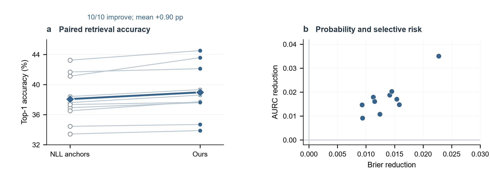
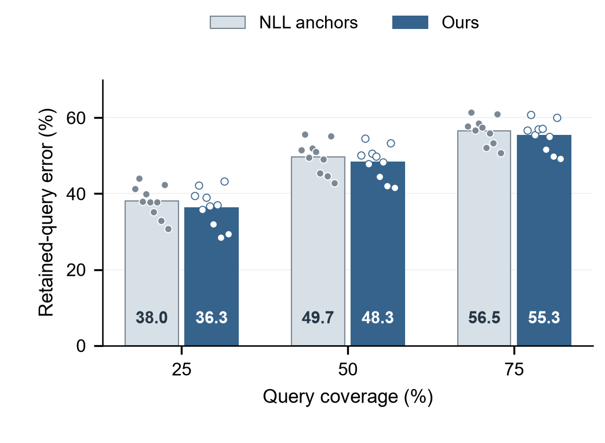
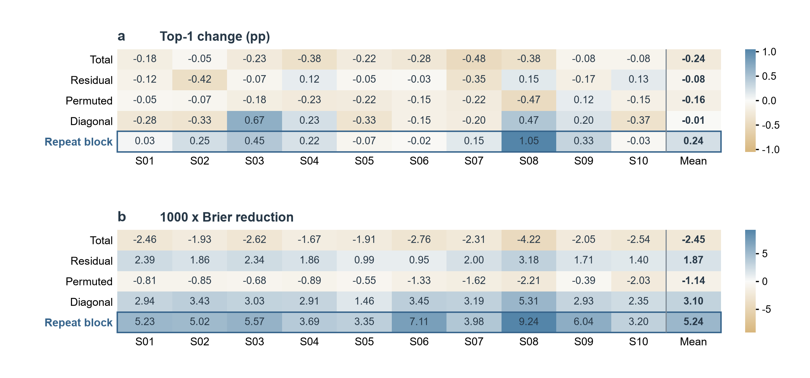

# Repeat-Aware Scoring for Calibrated EEG-to-Image Retrieval

Artifacts for **Compare and Weigh**, accompanying *Repeat-Aware Scoring for
Calibrated EEG-to-Image Retrieval*. This repository contains the implementation,
complete 45-configuration results, frozen main-comparison predictions, and
figure source data.

## Quick start: inspect and reproduce reported results

Use Python 3.12 in an isolated environment. No EEG recordings, checkpoints,
network access, or GPU are needed for the frozen-prediction replay.

```bash
python -m pip install -r requirements.txt
python verify_artifacts.py
python reproduce.py
```

The replay reads **180 NPZ files** covering 10 participants, three seeds,
three galleries and two matched scorers. It recomputes **66 aggregate metrics**
and checks the ranks of the same six recorded cases for the main pair.
The validated replay has a maximum absolute difference of **0.0** from the
recorded summary. A new report is written to `outputs/`, leaving committed
inputs unchanged.

This is reproduction of metrics from original frozen predictions. The original
training and evaluation protocol, including the exploratory development
history, is documented in the manuscript and `REPRODUCIBILITY.md`.

## Recreate the scientific figures

```bash
python -m pip install -r requirements-figures.txt
python make_figures.py
```

This exports the six English figures to `outputs/figures/en/`. On Windows with
the installed SimHei font, both language editions can be generated with:

```bash
python make_figures.py --languages en zh
```

Figures 3--5 use paired accuracy slopes, zero-based coverage bars with all
participant points, and signed participant-level heatmaps, respectively.
No numerical panel uses synthetic observations, fitted display curves, or
participant exclusions. Figure 5 labels its Brier reduction in units of 1/1,000.
Its signed changes include negative values. Figures 1--2 contain explicitly
schematic glyphs; the six CC0 photographs illustrate concepts rather than
experimental stimuli or model predictions.

### Data-driven figure previews







Figure 6 displays six CC0 concept photographs beside all ten actual candidate
record IDs for each case, including 44 records selected by none of the four
scorers. Run `python verify_cases.py` to check the 24 model choices and ranks.
The concept photographs are illustrations; they are not substituted stimuli
or displayed model outputs.

## Repository map

```text
artifacts/
  results/                    # 45 configurations, three galleries, diagnostics
  predictions/                # 180 original frozen prediction files
  reproduce_frozen.py         # numerical replay implementation
  prediction_provenance.json  # frozen-output source hashes
data/code/
  experiments/                # original model/scoring/analysis implementations
  preprocess_*.py             # original recording preparation implementations
  upstream/                   # selected unmodified MIT-licensed source snapshots
figures/
  draw_figures.py             # editable plotting implementation
  source_data/                # recorded summaries, case log and CC0 assets
  en/, zh/                    # editable SVGs and delivered geometry/font audits
  plotted_data/               # participant values underlying Figures 3--5
docs/EXPERIMENT_MAP.md         # paper-to-file navigation
DATA_AVAILABILITY.md           # data access and redistribution boundaries
REPRODUCIBILITY.md             # protocol, environment and replay scope
LICENSES.md                   # rights and third-party notices
artifact_manifest.json        # file metadata and checksums
checksums.sha256               # machine-readable integrity record
```

The 38 original implementation/preparation files retain their bytes and source
layout. Three upstream MIT license files accompany the selected NICE, ATM and
SATTC sources. There are no local audit histories, CMT conflict declarations,
credentials, manuscript PDFs or extra paper appendices in this repository.

## Data, access and interpretation

The source study reuses THINGS-EEG2, with the original data and access routes
listed in `DATA_AVAILABILITY.md`. The artifact package contains derived result
records and frozen logits; it does not redistribute original EEG recordings,
THINGS stimulus photographs, trained checkpoints or large feature banks.
Training from raw data additionally requires the original inputs and model
assets. This package is prepared as a Regular-paper artifact, without claiming
the full self-contained retraining environment required for an EAB submission.

Three seeds are averaged within each participant; the ten participants are the
statistical units. The reported tasks use participant-specific R4 queries and
supplied K10/K200 galleries, with concept membership provided for within10.
Full result files retain the alternatives that optimize other single metrics.

## Citation and authors

See `CITATION.cff` for author metadata. Cite the manuscript and the original
datasets and methods when using the corresponding material.
